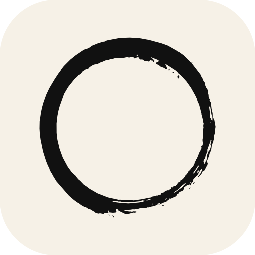

# Painter

<p align="center">
  
</p>

<p align="center">
  <strong>A high-performance, GPU-accelerated digital painting and comic creation suite written in Rust.</strong><br>
  <em>Engineered with wgpu + egui — inspired by the workflow of Clip Studio Paint. 100% original implementation.</em>
</p>

<p align="center">
  <a href="#build--install"></a>
  <a href="#licence"></a>
  
  
</p>

---

## 📑 Table of Contents

- [Overview](#overview)
- [Architecture & Deep Dives](#architecture--deep-dives)
- [Key Features](#key-features)
  - [🎨 Painting & Brush Engine](#-painting--brush-engine)
  - [📑 Layer System & Composition](#-layer-system--composition)
  - [📖 Comic, Manga & Balloon Tools](#-comic-manga--balloon-tools)
  - [🧊 3D Reference Layer & Posing](#-3d-reference-layer--posing)
  - [⚡ Hardware Acceleration & Legacy Optimization](#-hardware-acceleration--legacy-optimization)
  - [📱 Touch, Stylus & Mobile Ergonomics](#-touch-stylus--mobile-ergonomics)
  - [🔄 Format Interchange & Scanner IO](#-format-interchange--scanner-io)
- [Build & Install](#build--install)
- [Keyboard Shortcuts](#keyboard-shortcuts)
- [Platform Binaries & Packaging](#platform-binaries--packaging)
- [Licence & Credits](#licence--credits)

---

## Overview

**Painter** is a desktop and tablet painting application crafted in Rust, combining the speed of hardware-accelerated GPU pipelines (`wgpu`) with the responsiveness of immediate-mode GUI (`egui`). Designed from the ground up to respect creative muscle memory, Painter provides full brush compatibility across leading digital art suites, native comic page layouts, integrated 3D poseable reference layers, and seamless interchange with `.clip`, `.psd`, `.kra`, and `.ora` files.

---

## Architecture & Deep Dives

- 🗺️ **[FEATURE_MAP.md](docs/FEATURE_MAP.md)** — Targeted workflows, specification progress and roadmap.
- 🏗️ **[ARCHITECTURE.md](docs/ARCHITECTURE.md)** — Modular crates, sparse GPU Tile Atlas, data flows and internal file formats.
- 🖌️ **[BRUSH_IO.md](docs/BRUSH_IO.md)** — Comprehensive specification of brush ingestion: Clip Studio (`.sut`/`.todb`), Photoshop (`.abr`), Krita (`.kpp`/`.bundle`), MyPaint (`.myb`), GIMP (`.gbr`/`.gih`/`.vbr`), and native `.rustbrush`.

---

## Key Features

### 🎨 Painting & Brush Engine
- **Universal Brush Engine**: Full support for round, sampled, and dual tips with procedural dynamics, spacing, jitter, elliptical angle tracking, and texture patterns.
- **Multi-Format Ingestion**: Seamlessly import and export brushes from Photoshop (`.abr`), Clip Studio Paint (`.sut`/`Material`), Krita (`.kpp`/`.bundle`), GIMP (`.gbr`/`.gih`), and MyPaint (`.myb`).
- **Interactive Stabilization & Smoothing**: Configurable stream stabilization, Kalman filtering, and moving average smoothing for crisp line art.
- **Smart Shape Assist**: Hold the pen still at the end of a stroke to snap into clean circles, ellipses, rectangles, or triangles.
- **Clone Stamp, Pattern Stamp & History Brush**: Revert strokes, sample from layers with alignment, or paint custom patterns directly on the canvas.

### 📑 Layer System & Composition
- **Diverse Layer Types**: Raster, vector, isolated/pass-through folders, paper, gradient, and live screentone layers.
- **Full Blending & Masks**: 13 blend modes, clipping masks, user transparency masks, lock alpha, and editable layer color tints (e.g. non-destructive cyan line art).
- **Adaptive Thumbnail Previews**: Configurable layer thumbnails with content-bounded zoom (enlarging isolated sketch bounds) or entire-canvas overview.
- **Live Non-Destructive Effects**:
  - *Border Effect*: Crisp outline or soft watercolor fringing.
  - *Extract Line*: Real-time edge detection and line extraction from photographs.
  - *Screentone Generator*: Frequency (lpi), custom dot shapes (circle, square, diamond, line, cross, noise), and angle adjustments.
- **File Object Layers**: Non-destructive linked external documents (PNG, PSD, KRA, CLIP, SVG, ORA) that re-render sharp under continuous transformation.
- **Vector Layers & Precision Editing**: Intersecting line eraser (cuts up to line crossings), bezier point manipulation, and path simplification.

### 📖 Comic, Manga & Balloon Tools
- **Comic Page & Storyboard Wizard**: Standard templates with bleed margins, safe areas, binding lines, and multi-panel page numbering.
- **Panel Frame Tool**: Slice canvas into panel boxes, adjust borders, snap gutters, and nest panel-specific art layers.
- **Speech Balloons & Tails**: Rounded, thought, flash, and organic hand-drawn balloons with multi-jointed tail handles.
- **Typography Engine**: Font discovery, character spacing, line height, text balloon auto-fit, and vertical text flow for manga reading directions.

### 🧊 3D Reference Layer & Posing
- **Integrated 3D Reference Engine**: Load glTF/GLB, OBJ, FBX, and Blender files (`.blend`, versions 2.80 through 5.x, plain, gzip, or zstd).
- **Smooth Navigation & Presets**: Orthographic & perspective view transitions with cubic ease-out slerp animations and continuous turntable spin (`T`).
- **Posing & Rigging**: Interactive bone transformation with drag cancellation, joint manipulation, and undo/redo checkpoints.
- **Live 3D Texture Painting**: Paint directly onto 2D texture documents and watch changes push to the 3D model in real time.
- **Directional & Attenuated Lighting**: Multi-light setups featuring sunlight and distance-attenuated point lights.

### ⚡ Hardware Acceleration & Legacy Optimization
- **Sparse GPU Tile Atlas**: Efficient memory architecture allocating only painted $64 \times 64$ tiles.
- **Low-VRAM & Downlevel Profile**: Viewport-constrained rendering, stroke bounds clipping, and dynamic atlas page shrinking for older GPUs (e.g. Intel GMA / ThinkPad X200).
- **Background Paging & Memory Capping**: Inactive document tabs suspend memory consumption and swap undo histories to disk under tight RAM budgets.
- **OpenGL & WebGL2 Fallback**: Automatic detection of downlevel GPU capabilities with transparent software or OpenGL fallback.

### 📱 Touch, Stylus & Mobile Ergonomics
- **Hybrid Palm Rejection**: Geometric wrist-cone masking, contact radius classification, and touch rollback.
- **On-Screen Modifier Keys**: Persistent, latchable Ctrl, Shift, and Alt buttons on touch devices (iPadOS & Android).
- **Two-Finger Navigation**: Seamless pinch-to-zoom, two-finger pan, canvas rotation, and two-finger tap to undo.

### 🔄 Format Interchange & Scanner IO
- **Document Compatibility**: Read and write `.painter`, Photoshop `.psd` (RGB, Grayscale, CMYK), Krita `.kra`, Clip Studio `.clip`, and OpenRaster `.ora`.
- **Centerline & Outline SVG Export**: Vectorize raster layers or export clean SVG outlines with Inkscape-compatible layer hierarchies.
- **Direct Scanner Integration**: WIA on Windows, SANE on Linux, eSCL (AirScan) network scanning across all platforms, and camera document scanning on iOS/Android.

---

## Build & Install

### Prerequisites
- Stable **Rust 1.88+** (`rustup update stable`).
- **Windows**: MSVC C++ Build Tools ("Desktop development with C++").
- **Linux**: `libgtk-3-dev libxkbcommon-dev libwayland-dev libx11-dev` (and `libsane-dev` for USB scanners).

### Quick Start

```bash
# Clone the repository
git clone https://github.com/cr0ma-gh/painter.git
cd painter

# Run Painter in release mode
cargo run --release -p painter-app

# Run all workspace unit, integration, and GPU parity tests
cargo test --workspace
cargo test -p painter-render --test gpu_parity
```

Launch Painter opening a specific canvas directly:
```bash
cargo run --release -p painter-app -- my_artwork.painter
```

---

## Keyboard Shortcuts

| Shortcut | Action |
| :--- | :--- |
| <kbd>B</kbd> / <kbd>E</kbd> | Brush / Eraser tool |
| <kbd>G</kbd> / <kbd>Shift</kbd>+<kbd>G</kbd> | Fill bucket / Gradient tool |
| <kbd>M</kbd> / <kbd>Shift</kbd>+<kbd>M</kbd> / <kbd>L</kbd> | Rectangle / Ellipse / Lasso selection |
| <kbd>Space</kbd> + drag / Middle Click | Canvas Pan |
| <kbd>Ctrl</kbd> + <kbd>Space</kbd> + drag / <kbd>/</kbd> | Scrubby Canvas Zoom |
| <kbd>Shift</kbd> + <kbd>Space</kbd> + drag / <kbd>R</kbd> | Canvas Rotate |
| <kbd>Ctrl</kbd> + <kbd>0</kbd> | Fit canvas to window |
| <kbd>[</kbd> / <kbd>]</kbd> | Decrease / Increase brush size |
| <kbd>X</kbd> | Swap primary and secondary color |
| <kbd>Ctrl</kbd>+<kbd>Z</kbd> / <kbd>Ctrl</kbd>+<kbd>Shift</kbd>+<kbd>Z</kbd> | Undo / Redo |
| <kbd>Ctrl</kbd>+<kbd>T</kbd> / <kbd>C</kbd> | Free Transform / Canvas Crop |
| <kbd>U</kbd> / <kbd>Shift</kbd>+<kbd>U</kbd> | Comic Panel Frame / Geometric Shape tool |
| <kbd>T</kbd> / <kbd>Shift</kbd>+<kbd>T</kbd> | Text tool / Speech Balloon tool |
| **3D Tool**: Middle drag / <kbd>Shift</kbd> / <kbd>Ctrl</kbd> | Orbit / Pan / Dolly 3D camera |
| **3D Tool**: <kbd>1</kbd> / <kbd>3</kbd> / <kbd>7</kbd> / <kbd>T</kbd> | Front / Right / Top views / Turntable spin |
| <kbd>Ctrl</kbd>+<kbd>N</kbd> / <kbd>Ctrl</kbd>+<kbd>O</kbd> / <kbd>Ctrl</kbd>+<kbd>S</kbd> | New canvas / Open file / Save |

*(Hold down tool keys such as <kbd>E</kbd>, <kbd>H</kbd>, or <kbd>R</kbd> for temporary spring-loaded switching!)*

---

## Platform Binaries & Packaging

Every commit builds multi-platform release artifacts through GitHub Actions:

- **Windows**: `Painter-Setup-windows-x86_64.exe` (clean single-user installer via `painter-installer`, importing CSP/Photoshop brushes automatically) and portable `painter.exe`.
- **Linux**: Standalone `Painter-x86_64.AppImage` with GTK 3 file dialogs, XInput2 tablet pressure/tilt, and Wayland/X11 support.
- **macOS**: Universal `Painter.dmg` for Apple Silicon (M1/M2/M3/M4) and Intel x86_64 Macs.
- **Android**: `Painter.apk` for ARM64 devices, complete with stylus pressure, soft-keyboard detection, and camera scanning.
- **iPadOS**: Unsigned `.ipa` package with Apple Pencil precision pressure, touch gestures, and Files app integration.

---

## Licence & Credits

- **Painter** is dual-licensed under either the [MIT Licence](LICENSE-MIT) or the [Apache 2.0 Licence](LICENSE-APACHE), at your option.
- **Icons**: Derived from the GIMP Symbolic Icon theme by the GNOME Project & GIMP Team ([CC BY-SA 4.0](crates/painter-app/assets/icons/COPYING)).
