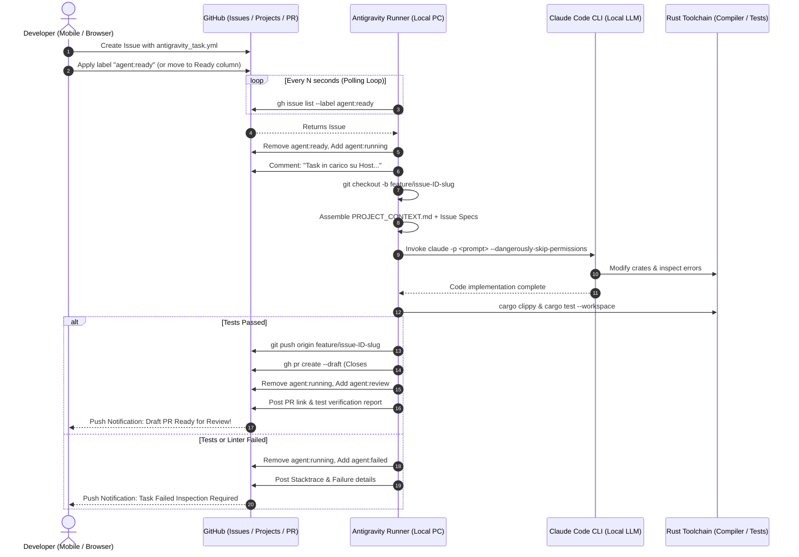

# 🌌 Antigravity Autonomous Workflow Guide
> **Continuous, Zero-Friction Remote Development for Painter**  
> Manage, prompt, and develop complex graphics features from your smartphone or browser while your local PC builds, tests, and PRs code in the background.

---

## 1. System Architecture & Information Flow

The Antigravity system transforms your local development machine into an autonomous graphics engineering agent. You trigger and steer development asynchronously via GitHub Issues and Projects from any device.



---

## 2. GitHub Setup (Project Board, Labels & Templates)

### A. Authentication & Required Scopes
GitHub Projects V2 commands require the `project` scope. Refresh your GitHub CLI authentication:
```bash
gh auth refresh -s project,repo,workflow
```

### B. Project Board V2 Creation via GitHub CLI
To create a Kanban / Table board linked to `painter`:

```bash
# 1. Create the Project V2 board
gh project create --owner cr0ma-gh --title "Painter Development & Antigravity Board"

# 2. Note the Project number from the output (e.g. 1) and link the repo:
gh project link 1 --owner cr0ma-gh --repo cr0ma-gh/painter

# 3. Add the custom single-select "Agent Status" field:
gh project field-create 1 --owner cr0ma-gh \
  --name "Agent Status" \
  --data-type "SINGLE_SELECT" \
  --single-select-options "Backlog,Ready for Agent,Agent Running,Ready for Review,Done"
```

> **Automated Script**: You can also simply run:
> - **Linux/macOS/Git Bash**: `bash scripts/setup_project_board.sh`
> - **Windows PowerShell**: `powershell -ExecutionPolicy Bypass -File scripts/setup_project_board.ps1`

### C. Issue Templates (`.github/ISSUE_TEMPLATE/`)
The repository includes three high-fidelity issue forms:
1. [antigravity_task.yml](file:///.github/ISSUE_TEMPLATE/antigravity_task.yml): Specialized high-density specification template with fields for target crates, architectural invariants (CPU/GPU parity, tile atlas), acceptance criteria, and priority dropdown. Automatically adds `agent:ready` and `type:antigravity`.
2. [feature_request.yml](file:///.github/ISSUE_TEMPLATE/feature_request.yml): Structured proposals for brush engine, wgpu canvas viewport, shortcuts, and layer stack features. Adds `type:feature` and `status:backlog`.
3. [bug_report.yml](file:///.github/ISSUE_TEMPLATE/bug_report.yml): Detailed bug reproduction with hardware GPU, driver version, tablet WinTab/Ink environment, and stack traces. Adds `type:bug`.

### D. Label Taxonomy
All labels are pre-configured in the repository:
| Category | Label | Color | Purpose |
|---|---|---|---|
| **Workflow State** | `agent:ready` | `#0E8A16` | Triggers the local runner to pick up the task. |
| | `agent:running` | `#FBCA04` | Task currently locked and executing on local PC. |
| | `agent:review` | `#1D76DB` | Code written, tests green, Draft PR opened. |
| | `agent:failed` | `#D93F0B` | Build, linter, or test gate failed. Stacktrace attached. |
| | `status:backlog` | `#6E5494` | Planned work not yet ready for agent execution. |
| | `status:done` | `#0052CC` | PR merged and task verified. |
| **Workspace Scope** | `scope:core` | `#5319E7` | `painter-core`: TileStore, rasterizer, CPU engine. |
| | `scope:render` | `#006B75` | `painter-render`: wgpu 24, WGSL shaders, tile atlas. |
| | `scope:app` | `#BFD4F2` | `painter-app`: eframe/egui UI, docking, WinTab/Ink. |
| | `scope:brush-io` | `#D4C5F9` | `brush-io`: .abr, .sut, .todb, .rustbrush formats. |
| | `scope:transform` | `#C2E0C6` | `transform-tools`: mesh warp, perspective warp. |
| | `scope:comic` | `#FEF2C0` | `comic-layout`: frame panels, comic wizard. |
| | `scope:scene-3d` | `#F9D0C4` | `scene-3d`: 3D poseable model reference layer. |
| | `scope:vector` | `#C5DEF5` | `vector-export`: SVG paths, stroke extraction. |
| **AI Engine Routing** | `engine:antigravity` | `#4285F4` | Route task to Google Antigravity (agy / SDK). |
| | `engine:claude` | `#D97706` | Route task to Anthropic Claude Code CLI. |
| **Priority** | `priority:critical` | `#B60205` | Immediate blocker (Runner prioritizes first). |
| | `priority:high` | `#D93F0B` | High priority in execution queue. |
| | `priority:medium` | `#FBCA04` | Standard priority. |
| | `priority:low` | `#0E8A16` | Background / polish task. |

---

## 3. Local Engine: Installation & Execution Modes

### A. Local Prerequisites & Supported AI Engines
The runner supports two state-of-the-art agent backends:

1. **Google Antigravity (`agy` CLI / Python SDK)**:
   - **Python SDK**: `pip install google-antigravity` (enables in-process async agent execution with native streaming and tool execution).
   - **CLI**: `agy` executable on system PATH (`https://antigravity.google/docs/cli/reference`).
   - **API Key Requirement**: Requires a Gemini API key (free at [Google AI Studio](https://aistudio.google.com/)). Configure it via:
     - **File `.env`** (recommended): Create a `.env` file (copy from `.env.example`):
       ```env
       GEMINI_API_KEY=AIzaSy...
       ```
     - **PowerShell (Windows)**:
       ```powershell
       $env:GEMINI_API_KEY="AIzaSy..."
       ```
     - **Bash (Linux/macOS/WSL)**:
       ```bash
       export GEMINI_API_KEY="AIzaSy..."
       ```
     - **CLI Argument**: `--gemini-api-key "AIzaSy..."`
2. **Claude Code (`claude` CLI)**:
   - Installed globally via npm: `npm install -g @anthropic-ai/claude-code`.
   - Requires `ANTHROPIC_API_KEY` (or interactive browser login via `claude`).
3. **Core Tooling**:
   - **GitHub CLI (`gh`)**: Authenticated (`gh auth refresh -s project,repo,workflow`).
   - **Rust Toolchain**: `cargo`, `clippy`, and `rustfmt`.
   - **Python 3.10+**.

### B. Dynamic Engine Routing (Antigravity vs Claude Code)
You can route tasks to either Google Antigravity or Claude Code dynamically:
- **Per-Issue Label**: Add `engine:antigravity` or `engine:claude`.
- **Per-Issue Template**: Select the engine directly from the "Motore AI / Agent Backend" dropdown in `antigravity_task.yml`.
- **Global Flag**: Pass `--engine antigravity` or `--engine claude` (default: `--engine auto`).
- **Environment Variable**: `export ANTIGRAVITY_ENGINE=antigravity`.

### C. Execution Modes

#### Mode 1: Continuous Autonomous Daemon (Default)
Polls GitHub every 60 seconds (configurable), picks up the highest priority ready issue, processes it, and returns to polling:
```bash
# Python Engine with Google Antigravity
python scripts/antigravity_runner.py --daemon --interval 60 --engine antigravity

# Python Engine with Claude Code
python scripts/antigravity_runner.py --daemon --interval 60 --engine claude

# Or Auto-detection (default)
python scripts/antigravity_runner.py --daemon --interval 60

# Or Bash Watcher (Linux / macOS / Git Bash)
bash scripts/watcher.sh --engine antigravity

# Or Native PowerShell Watcher (Windows)
powershell -ExecutionPolicy Bypass -File scripts/watcher.ps1 -Engine antigravity -Interval 60
```

#### Mode 2: Single-Task Execution (`--once`)
Processes at most one pending task from the queue and immediately terminates. Ideal for scheduled cron jobs or manual trigger:
```bash
python scripts/antigravity_runner.py --engine antigravity --once
```

#### Mode 3: Targeted Issue Execution (`--issue <ID>`)
Directly runs the autonomous pipeline on a specific issue ID regardless of queue order:
```bash
python scripts/antigravity_runner.py --issue 12 --engine antigravity
```

#### Mode 4: Interactive Guided Mode (`--interactive <ID>`)
Creates the branch, prepares the contextualized prompt with `PROJECT_CONTEXT.md`, and launches an interactive terminal session with the chosen engine (Google Antigravity `agy` or Claude Code `claude`):
```bash
# Interactive with Google Antigravity
python scripts/antigravity_runner.py --interactive 12 --engine antigravity

# Interactive with Claude Code
python scripts/antigravity_runner.py --interactive 12 --engine claude
```

#### Mode 5: Simulation Dry-Run (`--dry-run`)
Assembles the full prompt and tests the pipeline without making any commits, modifying GitHub labels, or opening PRs:
```bash
python scripts/antigravity_runner.py --issue 12 --engine antigravity --dry-run
```

---

## 4. Background Daemon Deployment

### Option A: Linux / WSL Systemd User Unit
Install and enable the provided systemd service:
```bash
# Copy unit to user systemd directory
mkdir -p ~/.config/systemd/user
cp scripts/antigravity.service ~/.config/systemd/user/

# Enable and start
systemctl --user daemon-reload
systemctl --user enable --now antigravity.service

# Check status and live logs
systemctl --user status antigravity.service
journalctl --user -u antigravity.service -f
```

### Option B: Tmux Session (Cross-Platform)
```bash
tmux new -s antigravity "python3 scripts/antigravity_runner.py --daemon --interval 60"
# Detach with: Ctrl+B then D
# Re-attach anytime with: tmux attach -t antigravity
```

### Option C: Windows Native Background Process
Run in a detached background PowerShell job:
```powershell
Start-Job -Name "AntigravityRunner" -ScriptBlock {
    Set-Location "C:\Users\utente\Documents\Painter"
    python scripts\antigravity_runner.py --daemon --interval 60
}

# View job status:
Get-Job -Name "AntigravityRunner"

# View job output stream:
Receive-Job -Name "AntigravityRunner" -Keep
```

---

## 5. Daily Remote Workflow (Mobile & Browser)

Here is how you develop features while away from your computer:

```
[On Mobile Phone / Coffee Shop / Transit]
   1. Open GitHub Mobile App or mobile browser.
   2. Go to cr0ma-gh/painter -> Issues -> "New Issue".
   3. Select "🤖 Antigravity Autonomous Task".
   4. Fill in:
      - Title: "[Task]: Add bicubic interpolation filter in painter-core"
      - Crate: painter-core
      - Constraints: 64x64 TileStore invariant, CPU/GPU parity.
      - Acceptance Criteria: cargo test passed, clippy clean.
   5. Submit Issue. (The issue automatically gets label "agent:ready").

[At Home / Office: Your PC Works Silently]
   1. Watcher detects Issue within 60 seconds.
   2. Transitions issue to "agent:running".
   3. Checks out branch `feature/issue-<id>-add-bicubic-interpolation`.
   4. Claude Code implements the algorithm and tests.
   5. Local compiler verifies `cargo clippy` and `cargo test --workspace`.
   6. Code pushed to origin, Draft PR created: `feat(issue-<id>): ...`.
   7. Issue updated with "agent:review" and link to PR.

[Back on Mobile Phone]
   1. You receive a GitHub push notification: "Pull Request #X opened".
   2. Open GitHub app, inspect the file diffs and test results.
   3. If everything looks good, tap "Merge Pull Request"!
```
